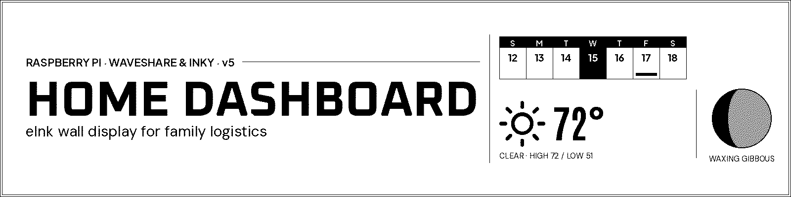
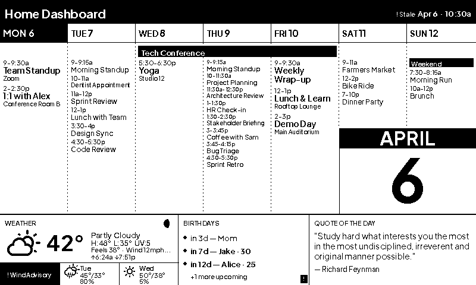

[](https://github.com/gkoch02/HomeDashboard/actions/workflows/ci.yml)
[](https://github.com/gkoch02/HomeDashboard/actions/workflows/github-code-scanning/codeql)
[](pyproject.toml)
[](https://www.raspberrypi.com)
[](LICENSE)

Home Dashboard is a low-maintenance eInk wall display for family logistics on a Raspberry Pi. It shows calendar events, weather, birthdays, quotes, and optional diagnostics on supported Waveshare and Inky displays, with graceful fallback behavior for unattended use.



The week's calendar comes from the Google Calendar API or a private ICS feed; the weather, forecast and optional PurpleAir air quality from their APIs; birthdays from a file, calendar events, or Google Contacts. A [catalog of built-in themes](docs/themes.md) can be fixed, scheduled or rotated at random, including a set for the 1360 × 480 panoramic panel. Each source is cached behind a circuit breaker, so an outage shows the last good data marked stale rather than a blank panel, and quiet hours stop refreshes overnight. An optional Web UI gives status, config editing and a manual refresh in the browser, and an [Apple TV companion](https://github.com/gkoch02/HomeDashboardTV) reads it to draw the same data natively on a TV.

## Running without hardware

With Python 3.10+ and `make`, run from a clone:

```bash
make setup
venv/bin/pip install -e ".[dev]"
make dry
make test
make lint
make docs-check
```

`make dry` writes `output/latest.png` using dummy data, without API credentials
or display hardware. Physical display behavior still requires testing on a Pi.

## Installing on a Pi

For a first install on a Raspberry Pi:

```bash
git clone https://github.com/gkoch02/HomeDashboard.git ~/home-dashboard
cd ~/home-dashboard
make pi-install
make configure
make dry
make pi-enable
make pi-status
```

If SPI was enabled for the first time during `make pi-install`, reboot once before your first live hardware refresh:

```bash
sudo reboot
```

After setup, these are the main operator commands:

```bash
make check      # validate config/config.yaml
make dry        # render output/latest.png with dummy data
make pi-status  # inspect timer/service status on the Pi
make pi-logs    # tail renderer logs
```

If something looks off, go to [docs/setup.md](docs/setup.md#troubleshooting-and-recovery) and [docs/faq.md](docs/faq.md).

## Documentation

| If you want to... | Read this |
|---|---|
| Install on a Pi and get the first render working | [Setup Guide](docs/setup.md) |
| Choose between ICS and Google service-account calendar setup | [Setup Guide](docs/setup.md#ics-feed-no-gcp-required) |
| Enable the optional browser control panel | [Web UI](docs/web-ui.md) |
| Pick or schedule themes | [Themes](docs/themes.md) |
| See the theme catalog in Inky Spectra 6 color | [Inky Previews](docs/inky-previews.md) |
| Run the 1360 × 480 panoramic panel (Waveshare 10.85" G) | [Panoramic Themes](docs/wide-themes.md) |
| See the full `config.yaml` reference | [Configuration Reference](docs/configuration.md) |
| Regenerate the per-theme preview images | [Theme Previews](docs/previews.md) |
| Find an answer to a common operational question | [FAQ](docs/faq.md) |
| Upgrade from an older install | [Upgrading from v4](docs/upgrading-from-v4.md) · [from v3](docs/upgrading-from-v3.md) |
| Develop locally without hardware | [Development](docs/development.md) |
| Understand the internals and design decisions | [Architecture](docs/architecture.md) |
| Contribute code or docs | [Contributing](CONTRIBUTING.md) |

There's also a project landing page at
[plumpbug.dev/homedashboard](https://plumpbug.dev/homedashboard/home.html), maintained in
the separate [`gkoch02/plumpbug-site`](https://github.com/gkoch02/plumpbug-site) repo
alongside the other Plumpbug-family projects. This repo stays the source of truth for the
theme preview PNGs that page embeds (`assets/previews/theme_<name>.png`); re-copy them
there if the themes are re-rendered.

## License

MIT — see [LICENSE](LICENSE).

The bundled typefaces under `fonts/` are third-party works under the SIL Open
Font License 1.1, each shipped with its upstream license text; the quotation
store in `config/quotes.json` collects short excerpts whose underlying text is
not ours to license. The **Third-party content** section of
[LICENSE](LICENSE) sets out both, along with the two non-permissive runtime
dependencies (`recurring-ical-events`, `caldav`).
